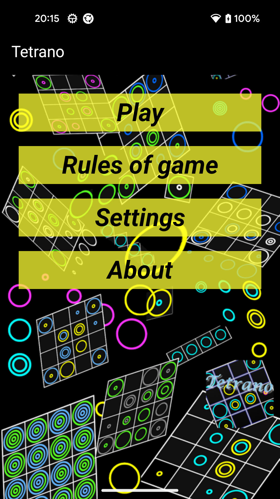
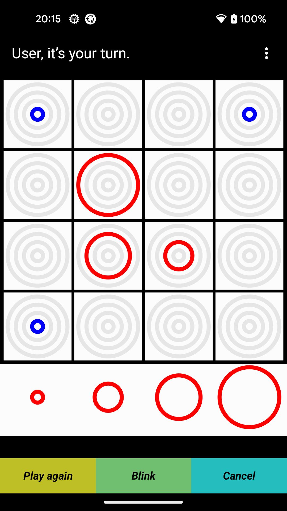
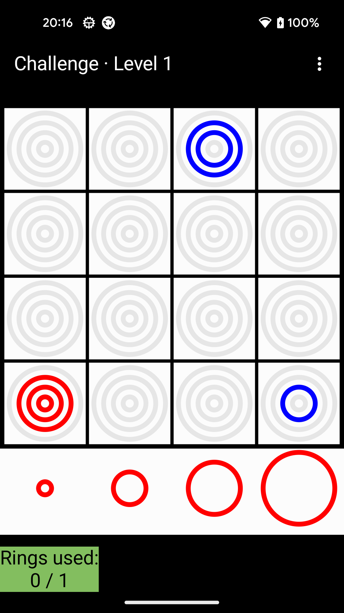

# Tetrano

[](LICENSE)

Tetrano is an Android board game for two players: a version of **Qubic** — tic-tac-toe in three
dimensions — played with rings on a flat board.

<p align="center">
  
  
  
</p>

## About

**Qubic** is tic-tac-toe in three dimensions: a cube of 4 × 4 × 4 cells, that is 64 cells and 76
possible lines. The first player to line up four pieces of their color wins. Sold as a board game
in the 1960s, it was solved in 1980 by Oren Patashnik: the first player can always force a win.

**Tetrano** is the two-dimensional representation of Qubic invented by **Maxime Vial** in 2004,
which this app uses: the four levels of the cube become four sizes of rings, placed on a 4 × 4
board. A line then reads as four concentric rings in one square, or as four rings in a row, all the
same size or in increasing or decreasing size.

**The app** was written by **Thibaut PERRIN**. Started in 2014, it was brought up to date in 2026
with the help of artificial intelligence: a complete rewrite, a new computer player based on a
neural network, puzzles and game analysis.

**Open source:** the source code is available here under the [MIT license](LICENSE).

## The app

- **Two players** on the same phone, each with a name and a ring color.
- **Against the computer**, from level 0 to level 100 (the original 2015 engine, which hunts for
  forks and blocks yours), plus **level 101**, a neural network trained by self-play that guides a
  Gumbel Monte-Carlo tree search, backed by an exact search for forced wins.
- **Challenge**: 245 levels, each starting from a game in progress that you must win with a
  limited number of rings. Hints are free.
- **Puzzles**: positions from real games where you can force a win; puzzles and players have an
  Elo rating, so puzzles stay at your level.
- **Analyse games**: finished games are saved automatically; replay them move by move with the
  neural network's verdict on each move, its live evaluation of the position, its suggested moves
  and your own variations — or start from an empty board.
- Rules and winning examples, in **English, French, German, Spanish, Italian and Russian**.
- No ads, no account, no internet access: nothing leaves the phone (see the
  [privacy policy](PRIVACY.md)).

To play, drag a ring from below the board and drop it on a square.

## Project structure

| Module | Contents |
|---|---|
| [`engine/`](engine) | The game in pure Kotlin/JVM: board, lines, the 2015 AI (levels 0–100), the neural network inference, Gumbel MCTS, tactics, puzzle solver. No Android dependency, so its tests run on the JVM. |
| [`app/`](app) | The Android app: Jetpack Compose, Hilt, Room (saved games, Challenge progress), DataStore (settings), and the one-time import of the 2015 app's data. |
| [`selfplay/`](selfplay) | A JVM command-line tool for self-play, arenas, benchmarks and puzzle generation. |
| [`tools/nn/`](tools/nn) | Python/PyTorch training of the level-101 network ([its own README](tools/nn/README.md), in French). |
| [`tools/qubic-solver/`](tools/qubic-solver) | Notes and experiments on solving Qubic. |
| [`docs/`](docs) | The 2026 rewrite plan, a French → English glossary of the 2015 code, the old online protocol. |

The history starts with the 2015 Java app (tag `v4.1-legacy`); version 5.0 is the 2026 rewrite.

## Building

Requirements: JDK 17 or later and the Android SDK (compile SDK 37). Then:

```bash
./gradlew assembleDebug        # build the app
./gradlew installDebug         # install it on a connected device
./gradlew test                 # engine and app unit tests
```

Release builds are signed outside this repository. If the Gradle daemon fails to start with
`Unable to establish loopback connection`, see [BUILDING.md](BUILDING.md).

## License

Tetrano is released under the [MIT license](LICENSE). The game Tetrano was invented by Maxime Vial.
